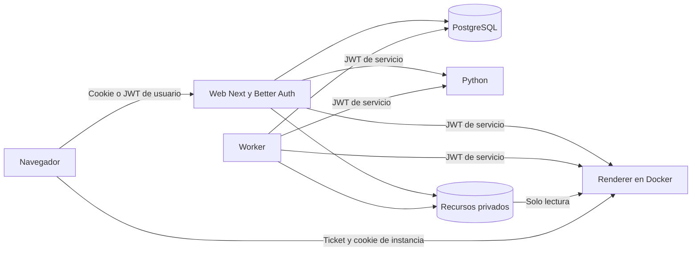

# Autenticación y operación del estudio

Entra en `/signin` con correo y contraseña. El registro está abierto en `/signup`. Cada cuenta tiene sus propios proyectos, archivos, trabajos y bibliotecas. El usuario inicial tiene los mismos permisos que cualquier propietario.



## Qué requiere identidad

| Superficie                                                                                                                                                                                            | Acceso                                                                                                                                                           |
| ----------------------------------------------------------------------------------------------------------------------------------------------------------------------------------------------------- | ---------------------------------------------------------------------------------------------------------------------------------------------------------------- |
| `/signin`, `/signup`, favicon y recursos estáticos de interfaz de Next                                                                                                                                | Públicos. El shell de entrada muestra el formulario.                                                                                                             |
| `/api/auth/[...all]`                                                                                                                                                                                  | Protocolo Better Auth. Registro, ingreso y `/api/auth/jwks` son públicos. La sesión autoriza la emisión en `/api/auth/token` y la gestión de sesión.             |
| `/`, `/video-wizard`, `/subtitle-generator`, `/content-intelligence`, `/jobs`, `/shorts`, `/projects`, `/templates`, `/assets`, `/styles`, `/brands`, `/components`, `/editor/[id]`, `/designer/[id]` | Sesión web. La redirección a ingreso conserva ruta y consulta locales. Un destino ajeno se reemplaza por `/projects`. Diseñador y editor validan el propietario. |
| `/remotion`, `/api/render-final`                                                                                                                                                                      | Exigen identidad antes de responder 501.                                                                                                                         |
| `/api/analyze-content`, `/api/create-clip`, `/api/generate-subtitles`, `/api/render-video-subtitles`, `/api/render-with-subtitles`, `/api/transcribe`, `/api/jobs` y `/api/jobs/[id]`                 | Identidad de usuario. Los trabajos y referencias de recursos se resuelven bajo el UUID del dueño.                                                                |
| `/api/studio/assets`, `assets/[id]`, `assets/[id]/metadata`, `catalog`, `libraries/[kind]`, `libraries/[kind]/[id]/[version]`, `library-editions`, `templates/[id]/instantiate`, `shorts`             | Todas bajo `/api/studio`. Listados, archivos, ediciones y operaciones del dueño autenticado.                                                                     |
| `/api/studio/projects`, `projects/[id]` y subrutas `audio`, `duplicate`, `restore`, `revisions`, `template`, `preview`, `renders` y `renders/[jobId]`                                                 | Proyecto propio. Las escrituras y los snapshots sujetos a una revisión base comprueban que siga vigente.                                                         |

### Procesador Python

Python valida los Bearer de servicio con `aud=video-wizard-processing`. Para cada operación firmada exige el `scope` indicado, el UUID `ownerId` y exactamente las referencias de la última columna.

| Método y ruta                     | Acceso                                    | Referencias adicionales |
| --------------------------------- | ----------------------------------------- | ----------------------- |
| `GET /health`                     | Público. Devuelve `{"status":"healthy"}`. | Ninguna                 |
| `POST /studio/transcribe-source`  | `source.transcribe`                       | `jobId`, `assetId`      |
| `POST /studio/crop-source`        | `source.crop`                             | `jobId`, `assetId`      |
| `POST /download-youtube`          | `source.download`                         | `jobId`                 |
| `GET`, `HEAD /output/{filename}`  | `crop.read`. Recibo del recorte.          | `jobId`, `assetId`      |
| `GET`, `HEAD /uploads/{filename}` | `download.read`. Recibo de la descarga.   | `jobId`                 |

El lector busca el archivo del recibo dentro del directorio del propietario y trabajo autorizados, y del recurso para los recortes. El recibo vence una hora después de crear el resultado. Cada lectura requiere su propio JWT vigente.

### Renderer

El renderer valida los Bearer de servicio con `aud=video-wizard-renderer`, el `scope` indicado, `ownerId` y exactamente las referencias de la última columna. Express también acepta `HEAD` en las rutas de lectura `GET` con la misma autorización.

| Método y ruta                   | Acceso                               | Referencias adicionales                                                |
| ------------------------------- | ------------------------------------ | ---------------------------------------------------------------------- |
| `GET /health`                   | Público. Devuelve `{"status":"ok"}`. | Ninguna                                                                |
| `POST /renders` (legacy)        | `render.create`                      | `jobId` igual a `webJobId` del cuerpo                                  |
| `GET /renders/:id`              | `render.read`                        | `jobId`, `rendererJobId` igual a `:id`                                 |
| `DELETE /renders/:id`           | `render.cancel`                      | `jobId`, `rendererJobId` igual a `:id`                                 |
| `GET /renders/:id.mp4`          | `render.artifact`. MP4 terminado.    | `jobId`, `rendererJobId` igual a `:id`                                 |
| `POST /renders` (StudioProject) | `studio.create`                      | `projectId` del snapshot                                               |
| `GET /studio/renders/:id`       | `studio.read`                        | `projectId`, `jobId` igual a `:id`                                     |
| `GET /studio/renders/:id/video` | `studio.artifact`. MP4 terminado.    | `projectId`, `jobId` igual a `:id`                                     |
| `POST /studio/previews`         | `preview.create`                     | `projectId` del snapshot y `previewId` igual a la instancia solicitada |
| `DELETE /studio/previews/:id`   | `preview.release`                    | `projectId`, `previewId` igual a `:id`                                 |

Para Remotion y HyperFrames, el iframe usa las siguientes rutas del renderer bajo `/studio/previews/:id/`. La cookie humana pertenece exclusivamente al host del editor. El navegador envía al host hermano del renderer la cookie Strict de la instancia. El editor entrega el ticket al frame mediante `postMessage` con el origen exacto.

| Método y ruta relativa      | Acceso                                                                                                                                                  |
| --------------------------- | ------------------------------------------------------------------------------------------------------------------------------------------------------- |
| `GET frame`, `GET shell.js` | Bootstrap público sin datos del proyecto.                                                                                                               |
| `POST session`              | Ticket de un solo uso de esa instancia en el cuerpo JSON y `Origin` igual a `STUDIO_PREVIEW_ORIGIN`. Responde 204 y entrega la cookie `studio_preview`. |
| `GET player.js`             | Cookie de la instancia vigente.                                                                                                                         |
| `GET native/*`              | Cookie de la instancia HyperFrames y archivo incluido en su manifiesto.                                                                                 |
| `GET media/:hash`           | Cookie de la instancia Remotion y hash de un recurso referenciado por su snapshot.                                                                      |

## Sesión, JWT y medios

Better Auth 1.7.27 usa el adaptador Drizzle y sesiones en PostgreSQL durante siete días, renovables tras un día. La cookie es HttpOnly y SameSite=Lax y usa Secure con HTTPS. La renovación de la cookie se realiza a través del protocolo de sesión del navegador. Las lecturas del backend consultan el estado activo sin caché de cookie.

El cliente obtiene un JWT Ed25519 de 15 minutos. Conserva el token en memoria y lo renueva con 30 segundos de margen. El encabezado lleva `alg=EdDSA` y `kid`. Los claims son `iss=BETTER_AUTH_URL`, `aud=video-wizard-api`, `sub` (UUID del usuario), `sid` (sesión), `token_use=user`, `iat` y `exp`. Cada llamada con Bearer valida firma, perfil y sesión activa del mismo UUID. Un Bearer inválido responde 401 aunque haya cookie. Cerrar sesión revoca esa sesión y sus JWT. Después de entrar, registrarse o salir, las otras pestañas reciben un aviso sin credenciales por el canal de Better Auth y consultan el estado de sesión. Un cambio de propietario oculta el espacio anterior e invalida el trabajo y el JWT que tenía en memoria.

Las peticiones JSON de la interfaz usan el cliente autenticado. SSR y medios del mismo origen pueden usar cookie. Las mutaciones por cookie requieren el `Origin` exacto del estudio. Better Auth aplica sus controles de origen y CSRF; `BETTER_AUTH_TRUSTED_ORIGINS`, si se define, solo puede contener el origen de `BETTER_AUTH_URL`. En producción el limitador predeterminado de Better Auth usa memoria por proceso y, con IP de cliente disponible, admite por regla general 100 solicitudes por 10 segundos y 3 por 10 segundos en ingreso, registro y cambios de credencial. En desarrollo el límite está desactivado por defecto. Un 429 pide esperar el tiempo indicado.

Las entradas de procesamiento son `sourceAssetId` o `jobId` propios con procedencia verificable. Se miden los archivos durante la ingesta. Un trabajo antiguo sin procedencia requiere volver a importar la fuente. Los clips y MP4 terminados se entregan por una ruta web del dueño. Se admite GET/HEAD, rango de bytes (206), 416 para un intervalo insatisfacible y caché privada. Los kits de marca que guarda el navegador se identifican por UUID. Los kits antiguos sin atribución quedan en su clave original.

Next y el worker emiten JWT HS256 nuevos por operación, con `iat` (emisión), `exp=iat+300` en segundos, un UUID `jti` por emisión, `iss=video-wizard-backend`, `sub=video-wizard-worker`, `token_use=service`, `ownerId`, `scope` exacto, referencias de trabajo/proyecto/instancia/recurso según proceda y `aud=video-wizard-processing` o `video-wizard-renderer`. El plazo controla la admisión de la operación. Un trabajo aceptado puede finalizar después de que caduque la sesión humana. El renderer comprueba los hashes y sirve temporalmente al codificador solo el original y el logo autorizados. Su contenedor publica únicamente el puerto principal en loopback. Remotion tiene un proxy efímero que puede escuchar en todas las interfaces del contenedor. Localmente se usa Docker para aislarlo.

Los previews Remotion y HyperFrames usan el mismo intercambio. Next autoriza un snapshot y entrega al editor un ticket de un solo uso válido por dos minutos. El frame comprueba origen e instancia con `postMessage` y canjea el ticket en el origen de preview. La cookie HttpOnly, SameSite=Strict y Secure en HTTPS se limita a la ruta de esa instancia, con una duración de hasta una hora. El editor retira el preview al salir o cerrar sesión cuando sigue montado. Al perder la sesión ya no puede renovarlo. Una capacidad emitida puede seguir siendo válida hasta su retiro o caducidad.

## Configuración

| Variable                                                  | Dónde y para qué                                                                                                                                                                            |
| --------------------------------------------------------- | ------------------------------------------------------------------------------------------------------------------------------------------------------------------------------------------- |
| `DATABASE_URL`                                            | Next, migraciones, seed y worker. URL de PostgreSQL con la base y puerto correctos.                                                                                                         |
| `BETTER_AUTH_URL`                                         | Origen público exacto de Next, sin barra final. Para el estudio local, `http://app.video-wizard.localhost:3000`.                                                                            |
| `BETTER_AUTH_SECRET`                                      | Secreto privado de Better Auth de al menos 32 bytes.                                                                                                                                        |
| `STUDIO_RENDER_SECRET`                                    | Segundo secreto independiente de al menos 32 bytes, compartido por Next, worker, Python y renderer.                                                                                         |
| `STUDIO_EDITOR_ORIGIN`, `STUDIO_PREVIEW_ORIGIN`           | Orígenes exactos de editor y renderer visibles al navegador. Usa dos hosts del mismo sitio, p. ej. `http://app.video-wizard.localhost:3000` y `http://preview.video-wizard.localhost:3001`. |
| `REMOTION_SERVER_URL`, `PYTHON_ENGINE_INTERNAL_URL`       | Direcciones internas de Next/worker. En host, `http://127.0.0.1:3001` y `http://127.0.0.1:8000`; en Compose, nombres de servicio.                                                           |
| `STUDIO_DATA_DIR`                                         | Directorio privado absoluto de recursos del estudio, compartido por web y worker y montado en modo lectura en el renderer.                                                                  |
| `USE_OPENAI_API=false`                                    | Activa Whisper base local en Python. El análisis de contenido y la transcripción alojada requieren configuración del proveedor.                                                             |
| `SEED_USER_EMAIL`, `SEED_USER_NAME`, `SEED_USER_PASSWORD` | Opcionales y exclusivos del seed explícito. Omite la contraseña para que se genere un archivo privado.                                                                                      |

Genera cada secreto de forma independiente con un gestor de contraseñas y guárdalo en la configuración privada con permisos 0600. En Docker usa los orígenes y nombres de servicio del ejemplo de entorno raíz. La imagen configura la ruta Linux de Chromium. [Instalación con Compose](./DOCKER_SETUP.md)

## Base nueva o existente

En una base nueva configura la conexión y secretos y aplica los tres comandos desde la raíz. En una instalación que ya contiene datos detén web y worker, comprueba el nombre de base con `SELECT current_database()`, conserva una copia privada de los recursos y guarda una copia PostgreSQL en formato custom. Verifica que `pg_restore --list` pueda leerla antes de migrar. Pasa las credenciales con la configuración privada de PostgreSQL. El preflight lee conteos y detecta coincidencias entre correos tras quitar el espacio exterior y convertir a minúsculas. Resuelve las colisiones con el responsable de esas identidades antes de reintentar.

```sh
pnpm --filter web auth:preflight
pnpm --filter web db:migrate
pnpm --filter web auth:seed
```

La migración 0008 verifica las colisiones otra vez bajo bloqueo y conserva los UUID, propietarios, hashes bcrypt y tablas anteriores. Crea cuentas de credenciales de Better Auth para esos UUID y mantiene el timestamp histórico de verificación. Tras migrar, vuelve a entrar. Las altas nuevas aceptan entre 8 y 128 caracteres y usan scrypt con normalización Unicode NFKC. Las credenciales bcrypt existentes conservan su comparación histórica, también para contraseñas largas y Unicode. La columna antigua `password_hash` se conserva para diagnóstico. El código antiguo desconoce las cuentas y cambios de credencial creados después del corte. Para recuperar una copia anterior, planifica también cómo preservar y reconciliar las escrituras posteriores y el almacén de medios.

El seed aprovisiona el catálogo para `demo@video-wizard.local` (nombre inicial `Usuario de prueba`). Si crea la cuenta y genera la contraseña, la guarda en `.studio/bootstrap-user.json` con permisos 0600. Si la cuenta ya existe conserva nombre, UUID y contraseña. Puedes repetir el seed después de un fallo de aprovisionamiento del catálogo. El proceso de inicio ordinario no ejecuta el seed.

### Instalación Mac existente

El ayudante `scripts/local-studio.mjs` está acotado a la instalación local `localhost:5447/studio`. Lee `apps/web/.env.local`, `.env.studio-render` y, para Python, `apps/processing-engine/.env.local`. Conserva esos archivos y crea el overlay privado `.env.studio-auth` si hace falta. Requiere Node 22.12+, pnpm, el cliente PostgreSQL con pg_dump/pg_restore, FFmpeg, PostgreSQL en ejecución y el entorno Python 3.11 con el modelo Whisper base. Ejecuta en la raíz.

```sh
node scripts/local-studio.mjs prepare
node scripts/local-studio.mjs migrate
node scripts/local-studio.mjs build
docker build -f apps/remotion-server/Dockerfile -t video-wizard-renderer:local .
node scripts/local-studio.mjs renderer video-wizard-renderer:local
```

La migración comprueba host, puerto y nombre real, guarda un archivo privado en `.studio/backups/`, valida su índice y ejecuta las migraciones y el seed dos veces. Usa una terminal por servicio.

```sh
node scripts/local-studio.mjs python
node scripts/local-studio.mjs worker
node scripts/local-studio.mjs web
```

Abre <http://localhost:3000/signin>. Las entradas por localhost y 127.0.0.1 conservan ruta y query al redirigir al editor canónico. En el primer arranque con los nuevos hosts vuelve a iniciar sesión. Chrome resuelve los subdominios de localhost en loopback. Para clientes CLI sin esa resolución, usa una asignación por solicitud como `curl --resolve app.video-wizard.localhost:3000:127.0.0.1 http://app.video-wizard.localhost:3000/signin`. Con los servicios en ejecución, `node scripts/local-studio.mjs smoke` abre Chrome con el usuario demo, verifica la página privada y los controles de cuenta a 800 y 1280 píxeles y cierra la sesión. Guarda las capturas de la barra lateral en un directorio temporal privado. Para volver a iniciar un renderer ya creado con la misma configuración ejecuta `docker start video-wizard-studio-renderer`.

## Diagnóstico

- **401**. Comprueba el origen exacto, la sesión activa y la caducidad del JWT. Web y renderer necesitan dos hosts distintos bajo el mismo sitio y esquema. Ante una caducidad en el diseñador, vuelve a entrar con la misma cuenta para recuperar el documento en memoria. Las lecturas pueden reintentarse. Comprueba el estado antes de repetir una escritura de resultado desconocido.
- **404**. Una referencia de otro usuario o inexistente produce la misma respuesta. Verifica el propietario, la revisión y la procedencia del recurso. Un ticket consumido o vencido requiere abrir un preview nuevo.
- **409**. El servidor incluye la revisión vigente para que el editor resuelva el conflicto antes de guardar.
- **Trabajo aceptado sin resultado**. Revisa `/jobs` y la disponibilidad de Python, worker y renderer. Las asociaciones de los renders legacy en curso se conservan en memoria del renderer. Un reinicio puede dejar el identificador remoto inaccesible. Reconcilia la operación por el UUID durable antes de volver a enviarla. Un MP4 que el worker ya registró en Studio sigue disponible bajo su propietario.
- **Grabación o medios privados inaccesibles**. Comprueba que el montaje de solo lectura del renderer corresponde exactamente al almacenamiento de web y worker. Los recibos de lectura de Python vencen al cabo de una hora. Mantén privados los directorios de trabajo y respaldos.

## Aceptación aislada

Configura `STUDIO_TEST_DATABASE_URL` en el entorno o en el archivo privado `.env.studio-test`. Usa una base dedicada cuyo nombre termine en `_test`. La prueba consulta el nombre efectivo de PostgreSQL antes de crear un esquema aleatorio. Requiere FFmpeg/ffprobe, Chrome instalado, Python local con Whisper base precargado, una compilación de web y la imagen local del renderer. El recorrido funciona con Whisper local y rangos manuales.

Para compilar en una copia de trabajo aislada, configura `apps/web/.env.local` con permisos 0600. Next necesita `DATABASE_URL` apuntando a la base de pruebas, `BETTER_AUTH_URL` con un origen exacto (por ejemplo, `http://localhost:3000`), y los secretos independientes de pruebas `BETTER_AUTH_SECRET` y `STUDIO_RENDER_SECRET` de al menos 32 bytes cada uno. `STUDIO_TEST_DATABASE_URL` selecciona la base del recorrido en ejecución. El comando directo de pnpm evita el filtrado de variables de la tarea de build de Turbo. En la instalación Mac ya preparada, puedes usar `node scripts/local-studio.mjs build` para compilar con su configuración privada. Ejecuta desde la raíz.

```sh
pnpm --filter web build
docker build -f apps/remotion-server/Dockerfile -t video-wizard-renderer:local .
pnpm test --filter=web -- --mode journey test/auth-journey.test.mjs
```

La prueba levanta sus propios procesos y contenedor, migra un propietario bcrypt, registra otro, crea video y audio sintéticos, pide la transcripción local, guarda subtítulos y un fragmento, abre previews en Chrome y comprueba el archivo privado tras expirar la sesión que lo encoló. Imprime el directorio temporal privado de evidencia con las capturas y el MP4. En Linux define `STUDIO_TEST_CHROME` con la ruta a Chrome. Puedes seleccionar otra imagen local con `STUDIO_TEST_RENDER_IMAGE`.

Para verificar también original, recorte, logo, audio decodificado, ambos formatos de snapshot y tickets desde el contenedor, genera primero los fixtures nativos. Comparte el directorio de evidencia entre el productor y el consumidor.

```sh
export STUDIO_NATIVE_EVIDENCE_DIR="$(mktemp -d)"
pnpm --filter @workspace/hyperframes-worker test --mode native src/native-acceptance.test.ts
STUDIO_TEST_RENDER_IMAGE=video-wizard-renderer:local pnpm --filter remotion-server test --mode contained server/contained-render.test.mjs
```

## Propuestas de componentes

Las rutas de propuestas reciben el propietario de la sesión Better Auth. El identificador `requestId` correlaciona la entrada del mismo propietario, proyecto y revisión. La admisión del companion requiere un recibo verificado en R4.

Next envía al renderer un JWT de servicio con audiencia `video-wizard-renderer`, `ownerId`, `projectId`, `proposalId` y la operación `proposal.compile` o `proposal.check`. El renderer coteja esos vínculos antes de compilar o montar la propuesta. El compilador sólo lee las fuentes virtuales y las fachadas versionadas. El filtro acepta el dialecto visual documentado en `component-contract.ts`. El JavaScript se ejecuta en Chromium.

La revisión crea un preview por la misma sesión efímera con ticket y cookie acotada a instancia que el editor. Las capturas pertenecen a la propuesta y su lectura usa la sesión del propietario. La aplicación fija una versión privada en el proyecto. **Guardar en biblioteca** incluye esa misma versión en el catálogo del propietario.
